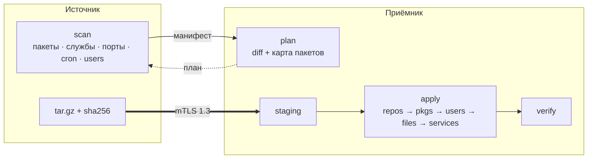

<div align="center">

# ⛴ ferry

**Переезд Linux-сервера на другой сервер — одной командой.**<br>
Пакеты, конфиги, службы, cron, пользователи и данные. Между Debian, Ubuntu, RHEL-семейством, SUSE, Arch и Alpine.

[](https://github.com/nullch/ferry/actions/workflows/ci.yml)
[](https://github.com/nullch/ferry/releases)
[](go.mod)
[](LICENSE)


<sub>автор: [@nullch](https://t.me/nullch) · канал: [@nullchdays](https://t.me/nullchdays)</sub>

[Быстрый старт](#-быстрый-старт) · [Кросс-дистрибутивный перенос](#-перенос-между-дистрибутивами) · [Архивы](#-архивы-и-восстановление) · [Команды](#-команды) · [Безопасность](#-безопасность) · [FAQ](#-faq)

</div>

---

## Зачем

Переезд сервера — это десятки мелочей: какие пакеты ставили руками, что лежит в `/etc` и изменено, какие службы включены, какие crontab'ы, какие порты слушаются, кто из пользователей что владеет. `ferry` сканирует исходный сервер, строит **план**, показывает его и только после подтверждения переносит всё на новый — по шифрованному каналу, с проверкой каждого файла.

- 🔐 **mTLS 1.3** — собственный мини-CA, без паролей и без SSH-доступа root.
- 🧭 **Сначала план** — `-dry-run` показывает, что будет сделано, ничего не меняя.
- 🌍 **Разные дистрибутивы** — таблица соответствия пакетов, службы и пользователи сопоставляются автоматически.
- ✅ **Контроль целостности** — sha256 каждого файла при отправке и приёме.
- ♻️ **Откат** — всё перезаписанное сохраняется в бэкап; apply можно повторить.
- 📦 **Режим архива** — просто положить `tar.gz` сервера на другой сервер и развернуть позже.
- 🪶 **Один статический бинарник**, только стандартная библиотека Go.



## Поддерживаемые системы

| Семейство | Дистрибутивы | Пакеты | Init |
|---|---|---|---|
| Debian | Debian, Ubuntu, Mint | `apt` | systemd |
| RHEL | RHEL, Rocky, AlmaLinux, CentOS, Fedora, Amazon, Oracle | `dnf` / `yum` | systemd |
| SUSE | openSUSE, SLES | `zypper` | systemd |
| Arch | Arch, Manjaro | `pacman` | systemd |
| Alpine | Alpine | `apk` | OpenRC |

Источник и приёмник могут быть **любой комбинацией** из таблицы (при одинаковой архитектуре: amd64↔amd64, arm64↔arm64).

## 🚀 Быстрый старт

```bash
# 1. Сборка (нужен Go ≥ 1.19) или скачайте бинарник из Releases
make build && sudo install -m 0755 bin/ferry /usr/local/sbin/ferry

# 2. Сертификаты — один раз, на любой машине
ferry pki -dir ./pki -hosts 203.0.113.10          # IP/DNS приёмника
#   приёмнику: ca.crt server.crt server.key  → /etc/ferry/pki/
#   источнику: ca.crt client.crt client.key  → /etc/ferry/pki/

# 3. На ПРИЁМНИКЕ (куда переезжаем)
sudo ferry serve                                    # или: systemd-run --unit=ferry-recv ferry serve

# 4. На ИСТОЧНИКЕ (откуда переезжаем)
sudo ferry scan                                     # что найдено
sudo ferry push -server 203.0.113.10 -dry-run       # план, без изменений
sudo ferry push -server 203.0.113.10 -start         # перенос + запуск служб
```

> **Базы данных** копировать файлами нельзя. Сделайте дамп в `/root/dumps` перед переносом — каталог `/root` уедет вместе со всем остальным. Подробности — в [разделе про базы](#базы-данных).

## 🌍 Перенос между дистрибутивами

Включается явно флагом `-cross-distro` (без него `plan` вернёт ошибку).

```bash
sudo ferry push -server rocky-host -cross-distro -dry-run
```

Что происходит автоматически:

| | Как решается |
|---|---|
| **Имена пакетов** | `apache2 → httpd`, `build-essential → gcc gcc-c++ make`, `php8.2-fpm → php-fpm`, `python3-foo → python-foo` и т.д. Таблица ≈ 60 строк + правила; своя — `-pkgmap my.map`. Нет аналога — пакет пропускается и показывается в плане |
| **Службы** | `apache2.service ↔ httpd.service`, `ssh ↔ sshd`, `cron ↔ crond`, `redis-server ↔ redis` …; systemd ↔ OpenRC (`rc-update`, `rc-service`) |
| **Владельцы файлов** | по имени, с синонимами: `www-data ↔ apache ↔ nginx ↔ http ↔ wwwrun` |
| **Группы** | `sudo ↔ wheel` для переносимых пользователей |
| **Cron** | спулы лежат в разных местах (`/var/spool/cron/crontabs`, `/var/spool/cron`, `/var/spool/cron/tabs`, `/etc/crontabs`) — файлы кладутся куда нужно |
| **Пользователи** | создаются обычные (uid ≥ 1000) с хэшами паролей и подходящим shell; системные не трогаются |
| **Репозитории** | **не переносятся** (у приёмника свои) |
| **Системные конфиги** | не переносятся: `/etc/apt`, `/etc/yum.repos.d`, `os-release`, `sysconfig`, SELinux… При смене **семейства** дополнительно: PAM, `sshd_config`, `sudoers`, `/etc/default`, init-скрипты |

Собственная таблица пакетов (`-pkgmap`) — одна строка на пакет, колонки `debian | rhel | suse | arch | alpine`; `-` — то же имя, `!` — аналога нет:

```
mytool-server | mytool | - | mytool-bin | -
```

> ⚠️ Другое семейство = другая PAM/SSH-конфигурация. `ferry` **намеренно** не копирует `sshd_config` и PAM, чтобы не отрезать вам доступ. Настройте доступ на приёмнике заранее и не закрывайте текущую SSH-сессию до проверки входа.

## 📦 Архивы и восстановление

Если переезжать сейчас не нужно, а сохранить данные сервера на другой — нужен архив:

```bash
# на другой сервер (там должен работать ferry serve)
sudo ferry push -server backup-host -archive

# или локально
sudo ferry archive -o /backup/server.tar.gz
```

Архив — обычный `tar.gz` (+ манифест: пакеты, порты, cron, пользователи). Целостность проверяется sha256. Разворачивание:

```bash
# как полноценный перенос (план → подтверждение → apply), в т.ч. на другом дистрибутиве
sudo ferry restore -archive /backup/server.tar.gz -cross-distro

# архив, полученный через push -archive (лежит в /var/lib/ferry/sessions/<id>/)
sudo ferry restore -session 20261015-101500-ab12cd34

# просто распаковать в каталог с сохранением владельцев и прав
sudo ferry restore -archive /backup/server.tar.gz -extract-to /mnt/restore
```

## 🧰 Команды

| Команда | Назначение |
|---|---|
| `ferry pki` | создать CA + серверный и клиентский сертификаты |
| `ferry scan [-o manifest.json]` | показать, что есть на этом сервере |
| `ferry serve [-listen :8443]` | приёмник |
| `ferry push -server HOST` | перенос на приёмник |
| `ferry archive -o FILE` | локальный `tar.gz` |
| `ferry restore -archive FILE` | развернуть архив |

Основные флаги `push` / `restore`:

| флаг | значение |
|---|---|
| `-dry-run` | только план |
| `-cross-distro` | разрешить другой дистрибутив |
| `-allow-release-mismatch` | разрешить другой релиз того же дистрибутива |
| `-start` | запустить службы, работавшие на источнике, и проверить порты |
| `-archive` *(push)* | положить `tar.gz` на приёмник, ничего не применяя |
| `-resume ID` *(push)* | повторить только apply для загруженной сессии |
| `-paths a,b` | заменить список каталогов |
| `-etc custom\|full\|none` | режим `/etc` (по умолчанию — только изменённое) |
| `-exclude a,b` | исключения (пути и маски: `/var/www/*/cache`) |
| `-skip-pkg a*,b` | не ставить пакеты |
| `-no-packages` | не ставить пакеты вообще |
| `-pkgmap FILE` | свои соответствия пакетов |
| `-yes` | без подтверждения |

## Что переносится

| Что | Как |
|---|---|
| `/var/www`, `/root`, `/home`, `/opt`, `/srv`, `/usr/local` | целиком: владельцы, права, suid, симлинки, mtime |
| crontab'ы | спул пользователей + `/etc/cron.d` |
| `/etc` (режим `custom`) | **только** то, чего нет в пакетах, и изменённые конфиги пакетов (сравнение с `dpkg` / `rpm -V` / `pacman -Qii` / `apk audit`) |
| службы | включённые юниты, свои unit-файлы, затем `enable` / `rc-update add` |
| пакеты | только поставленные вручную (`apt-mark showmanual`, `dnf repoquery --userinstalled`, `pacman -Qe`, `/etc/apk/world`, …) |
| пользователи и группы | отсутствующие на приёмнике, с хэшами паролей |

**Намеренно не переносится:** `fstab`, `hostname`, `hosts`, `machine-id`, сеть (`/etc/network`, netplan, NetworkManager), `resolv.conf`, SSH host-ключи, загрузчик/initramfs, ядро и firmware. Список — `neverApply` в [`common.go`](cmd/ferry/common.go).

**Не переносится автоматически:** файлы работающих БД, docker-тома и образы, ACL/xattr, правила файрвола.

### Базы данных

```bash
mkdir -p /root/dumps
mysqldump --all-databases --single-transaction --routines --events > /root/dumps/all-mysql.sql
sudo -u postgres pg_dumpall > /root/dumps/all-pg.sql
redis-cli SAVE && cp /var/lib/redis/dump.rdb /root/dumps/
```

Загрузите дампы на приёмнике после `apply` и только потом запускайте приложения. Если на источнике запущена БД или docker, `plan` предупредит об этом.

## 🔄 Порядок применения

1. репозитории приёмника → обновление метаданных
2. пакеты (с запретом автозапуска демонов на время установки — `policy-rc.d` на Debian)
3. группы и пользователи
4. файлы: владельцы пересчитываются по **имени**, существующие файлы уходят в `…/sessions/<id>/backup/`
5. перечитывание init, `enable` служб (с подбором имён)
6. запуск (`-start`)
7. проверка: активность служб и слушающие порты

## 🔐 Безопасность

- Канал: **взаимный TLS 1.3**, клиентский сертификат обязателен; клиентский сертификат нельзя использовать как серверный (EKU).
- Манифест содержит **хэши паролей** — он хранится на приёмнике в `/var/lib/ferry/sessions/<id>/session.json` с правами `0600`. После миграции удалите `/var/lib/ferry/sessions/*`.
- Приёмник запускайте только на время переноса и закрывайте порт файрволом для всех, кроме IP источника.
- Распаковка защищена от `..` и симлинков в путях; `passwd`/`shadow`/`fstab` и т.п. фильтруются и на стороне приёмника.
- Сообщить об уязвимости: [SECURITY.md](SECURITY.md).

## Ограничения

- Одна тяжёлая операция на приёмнике за раз; обрыв при передаче → `push` заново (докачки нет).
- Staging занимает столько же места, сколько данные (`/var/lib/ferry`); на одном разделе с целью файлы переносятся мгновенным `rename`.
- Файл, меняющийся во время копирования, добивается нулями с предупреждением — останавливайте писателей.
- Версии пакетов не пиннятся: ставится кандидат из репозиториев приёмника.
- Arch: держите приёмник обновлённым (`pacman -Syu`) — частичные обновления не поддерживаются.
- Пакеты вне репозиториев (`pip`, `npm -g`, ручные `.deb`/`.rpm`) приедут только как файлы в переносимых каталогах.

## ❓ FAQ

<details>
<summary><b>Чем это лучше rsync?</b></summary>

`rsync` копирует файлы. `ferry` ещё и знает про пакеты, службы, пользователей, cron, порты, считает план, сопоставляет имена между дистрибутивами и проверяет результат.
</details>

<details>
<summary><b>Можно ли перенести Ubuntu → Rocky?</b></summary>

Да: `ferry push -server HOST -cross-distro`. Смотрите план (`-dry-run`): там видно соответствия пакетов и то, что пропущено.
</details>

<details>
<summary><b>Что если пакета нет на приёмнике?</b></summary>

Он попадёт в предупреждения плана/apply («нет в репозиториях приёмника»), остальное продолжится. Добавьте соответствие через `-pkgmap` или поставьте вручную.
</details>

<details>
<summary><b>Как откатиться?</b></summary>

Перезаписанные файлы — в `/var/lib/ferry/sessions/<id>/backup/<исходный путь>`; пакеты откатывайте менеджером пакетов.
</details>

<details>
<summary><b>Нужен ли root?</b></summary>

Да, на обеих сторонах: читаются `/etc/shadow`, `/proc/*/fd`, ставятся пакеты, создаются пользователи.
</details>

## Разработка

```bash
make vet test build        # проверка, тесты, сборка → bin/ferry
make cross                 # linux/amd64 и linux/arm64 → dist/
```

Структура: [`cmd/ferry/`](cmd/ferry) — `main.go` (CLI), `distro.go` (определение ОС, правила кросс-переноса), `pkgmgr.go` (apt/dnf/zypper/pacman/apk), `pkgmap.go` (таблица пакетов), `services.go` (systemd/OpenRC), `scan.go`, `plan.go`, `apply.go`, `client.go`, `server.go`, `restore.go`, `pki.go`. См. [CONTRIBUTING.md](CONTRIBUTING.md).

API приёмника: `GET /v1/hello`, `POST /v1/plan`, `POST /v1/session[?mode=archive]`, `PUT /v1/session/<id>/data`, `PUT /v1/session/<id>/archive`, `POST /v1/session/<id>/apply`.

## Контакты

Автор — **nullch**: Telegram [@nullch](https://t.me/nullch), канал [@nullchdays](https://t.me/nullchdays), GitHub [nullch](https://github.com/nullch).

## Лицензия

[MIT](LICENSE)
